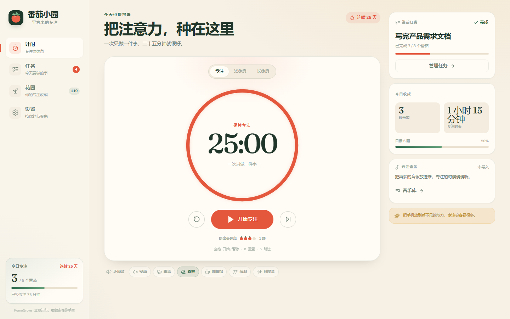
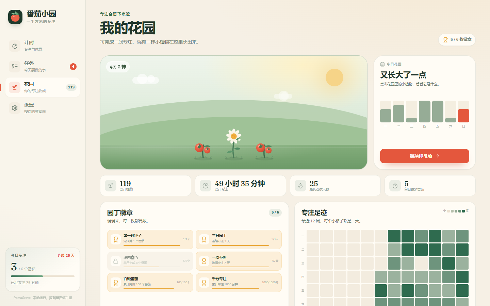
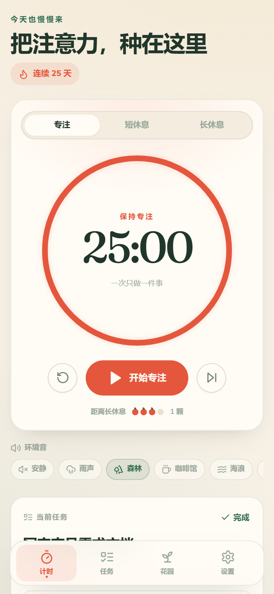
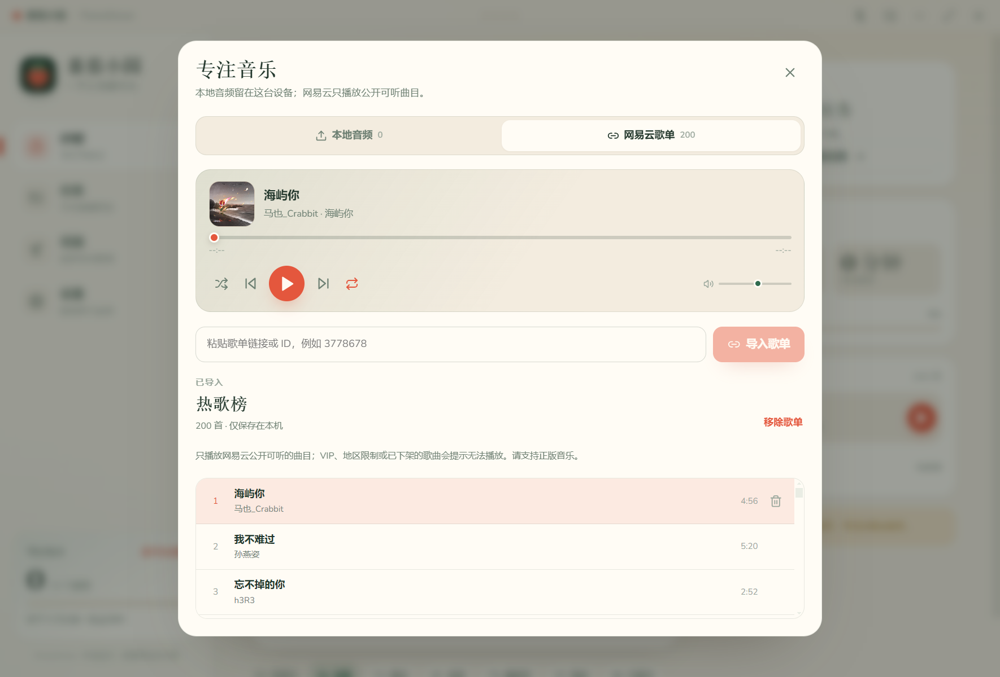

# 番茄小园 · PomoGrove

把每一次专注，种成一座只属于你的花园。

番茄小园是一款中文优先、离线优先的番茄钟。它把 **计时、任务、专注统计和植物收集** 放在同一个安静的界面里：每完成一段专注，花园里就会长出一株新的植物。Windows 与 Android 共用一套代码与数据模型，不注册、不上传；网易云歌单是可选的在线播放功能，本地音乐与专注数据始终留在本机。



| 桌面花园 | 移动端 |
| --- | --- |
|  |  |



## 功能

### 计时
- 专注 25 分钟、短休息 5 分钟、长休息 15 分钟，均可调整；默认每 4 个番茄进入一次长休息。
- 支持自动开始休息 / 自动开始下一段专注、跳过阶段、重置、阶段切换。
- 以绝对结束时间计时，切到后台、锁屏或系统休眠后回来不会“少算”。
- 快捷键：`空格` 开始/暂停，`R` 重置，`S` 跳过，`1` / `2` / `3` 切换专注、短休息、长休息。

### 任务
- 为任务估算番茄数，完成一个番茄自动累加；进行中的任务会显示在计时页。
- 任务可完成、恢复、删除、清空已完成；今日待办与预计投入一目了然。
- 完成任务不会自动结束计时，你可以按自己的节奏收尾。

### 花园与统计
- 每完成一段专注，按确定性规则长出一株植物：番茄、雏菊、郁金香、蕨、向日葵、蘑菇，共 6 种、3 档稀有度。
- 今日花园、本周节奏、连续天数、单日最多、累计专注、12 周专注热力图、近 30 天任务分布。
- 6 枚园丁徽章，记录从第一颗种子到一千分钟的路径。
- 所有植物由已完成记录推导，换设备导入备份后花园会完整恢复。

### 专注音乐
- 从手机或电脑导入本地音频（MP3 / M4A / WAV / FLAC / OGG / AAC / OPUS），单文件最大 300 MB，音频只保存在本机。
- 粘贴网易云公开歌单链接或 ID，即可读取歌单并在线播放公开可听的曲目；VIP、地区限制或已下架歌曲会给出提示。
- 支持播放 / 暂停、上一首 / 下一首、进度拖动、随机播放、单曲循环 / 列表循环、音量调节。
- 本地音乐存放在 IndexedDB，不上传、不写入 JSON 备份；网易云只缓存歌单信息，不下载音频文件。

### 声音与提醒
- 5 种程序合成环境音：雨声、森林、咖啡馆、海浪、白噪音；只在专注运行时播放。
- 完成音效（轻铃 / 木鱼钟声）与音量可调，支持试听。
- Windows 使用系统通知；Android 使用本地通知，可在应用退到后台后提醒。
- 触感反馈（Android）。

### Windows 桌面能力
- 无边框窗口、托盘常驻、关闭到托盘、开机自启。
- 全局快捷键 `Ctrl + Alt + P` 开始/暂停。
- 窗口置顶、迷你模式（400 × 620）、任务栏进度、托盘倒计时提示。
- 提供一键安装版与便携版两种分发形式。

### Android 能力
- 本地通知（含精确闹钟权限声明）、状态栏配色、启动图、返回键处理。
- 自适应图标与 Android 12+ 启动画面。
- 完全离线运行。

### 数据
- 数据保存在本机：Windows 为 Electron 用户数据目录中的 localStorage，Android 为 WebView localStorage。
- 本地音频以 Blob 形式保存在 IndexedDB（`pomogrove.music`），刷新或重启后仍在；导出备份不包含音频文件本身。
- 支持导出 / 导入 JSON 备份（设置、任务、全部专注记录、当前任务）。Windows 直接下载 `.json` 文件；Android 会调起系统分享，若不可用则复制到剪贴板。
- 清空数据需要二次确认；清空专注数据不会删除已导入的本地音乐，可在音乐库中单独删除。

## 安装与运行

### Windows 10 / 11（x64）

推荐安装版：[PomoGrove-1.1.0-setup.exe](https://github.com/mealess511/pomogrove/releases/download/v1.1.0/PomoGrove-1.1.0-setup.exe)

1. 双击安装包，按提示完成安装；默认安装到当前用户目录，不需要管理员权限。
2. 安装完成后从桌面或开始菜单启动“番茄小园”。卸载时不会自动删除专注数据。
3. 当前构建 **未做代码签名**，Windows SmartScreen 可能提示“未知发布者”。选择“更多信息 → 仍要运行”即可。
4. 数据目录：`%APPDATA%\PomoGrove`。可在设置中清空，或手动删除该目录。

便携版：[PomoGrove-1.1.0-portable.exe](https://github.com/mealess511/pomogrove/releases/download/v1.1.0/PomoGrove-1.1.0-portable.exe)

- 不写安装目录，双击即可运行；但每次启动都会把应用解压到临时目录，在低配机器或杀毒软件扫描下首次启动可能需要 1–3 分钟。日常使用建议安装版。
- 两个 Windows 版本使用同一份用户数据，可互相替换。

### Android（Android 6.0+）

产物：[PomoGrove-1.1.0-release.apk](https://github.com/mealess511/pomogrove/releases/download/v1.1.0/PomoGrove-1.1.0-release.apk)

1. 将 APK 传到手机，允许“安装未知应用”后安装。
2. 首次开启提醒时，系统会请求通知权限；Android 12+ 若希望锁屏后仍准时提醒，可能还需要在系统设置中允许“闹钟与提醒”。
3. 应用使用本地测试证书签名，适合自用与内测；上架应用商店前请替换为自己的正式签名。

> 两个安装包都由本仓库当前源码构建。Windows 版未签名，Android 版使用本地测试 keystore 签名（keystore 与口令不会上传到仓库）。

### 交付物与校验

| 文件 | 平台 | 大小 | SHA-256 |
| --- | --- | --- | --- |
| [`PomoGrove-1.1.0-setup.exe`](https://github.com/mealess511/pomogrove/releases/download/v1.1.0/PomoGrove-1.1.0-setup.exe) | Windows 安装版 | 83,818,680 B | `2bd45a4686e182035d93482451e211f7bd92d680302293a8e9ec0852bf94939c` |
| [`PomoGrove-1.1.0-portable.exe`](https://github.com/mealess511/pomogrove/releases/download/v1.1.0/PomoGrove-1.1.0-portable.exe) | Windows 便携版 | 83,618,166 B | `09b2d0054bb697002df2b8ceefc3a6278364495375178ba686d632f0193d918a` |
| [`PomoGrove-1.1.0-release.apk`](https://github.com/mealess511/pomogrove/releases/download/v1.1.0/PomoGrove-1.1.0-release.apk) | Android 6.0+ | 4,415,917 B | `a9868fbee60a135ab5cb498d2a81d9bbe83fbe03d4977755d3366ed1b5a1129a` |

完整校验清单见 [`CHECKSUMS.sha256`](https://github.com/mealess511/pomogrove/releases/download/v1.1.0/CHECKSUMS.sha256)。在 PowerShell 中校验：

```powershell
Get-FileHash .\release\PomoGrove-1.1.0-setup.exe -Algorithm SHA256
```

## 使用说明

- 在“计时”页选择阶段，按中央按钮开始；右侧可管理当前任务、查看今日目标、环境音与专注音乐。
- 在“专注音乐”卡片打开音乐库：拖入本地音频，或粘贴网易云歌单链接 / ID 后导入；点击曲目即可播放。
- 在“任务”页新建任务并估算番茄数，点击任务行设为当前任务，点击 ▶ 直接开始专注。
- 完成专注后会出现庆祝面板，可跳到花园查看新植物；面板 8 秒后自动收起。
- “设置”页可调整时长、每日目标、自动开始、主题、声音、通知、桌面行为，并导入/导出数据。

## 开发

### 环境

- Node.js 20+（本项目在 Node 26.13 上构建）
- npm
- Windows 打包：无需 Visual Studio；Electron 使用预编译二进制
- Android 打包：JDK 17、Android SDK Platform 34、Build-Tools 34.0.0
- 图标/截图脚本：本机 Chrome 或 Edge、Playwright Core（随 devDependencies 安装）

### 常用命令

```bash
npm install

npm run dev          # Vite 开发服务器（默认 5173）
npm test             # Vitest 单元测试
npm run build        # TypeScript 检查 + 生产构建
npm run screenshots  # 生成 screenshots/ 下的桌面与移动端截图

npm run icons          # 生成 Windows 图标与托盘图标
npm run dist:win       # 构建 Windows 便携版 exe
npm run dist:win:setup # 构建 Windows 一键安装包（推荐分发）

npm run android:assets # 生成 Android 图标、自适应前景与启动图
npm run android:sync   # 构建 Web 并同步到 android/
npm run android:apk    # 同步并构建签名 release APK
```

国内网络下 Electron 下载可设置镜像：

```powershell
$env:ELECTRON_MIRROR='https://npmmirror.com/mirrors/electron/'
$env:ELECTRON_BUILDER_BINARIES_MIRROR='https://npmmirror.com/mirrors/electron-builder-binaries/'
```

Android 构建需要 `ANDROID_HOME` 指向 SDK，并在 `android/local.properties` 写入 `sdk.dir`（Capacitor 通常会自动生成）。本仓库的 Gradle wrapper 使用腾讯云镜像下载 Gradle 8.2.1，Maven 依赖优先走阿里云镜像，可按需修改 `android/build.gradle`。

### Android 签名

- keystore：`android/app/pomogrove-release.keystore`
- 配置：`android/keystore.properties`
- alias：`pomogrove`

仓库内密码为本地测试用途（`PomoGrove2026`）。正式发布请生成新 keystore，并妥善保管，不要提交到公开仓库。

### 目录结构

```
pomogrove/
├─ src/
│  ├─ components/        # 布局、通用控件、植物 SVG、庆祝与 Toast
│  ├─ pages/             # 计时 / 任务 / 花园 / 设置
│  ├─ hooks/             # 计时引擎、主题、快捷键、环境音、桌面桥、唤醒锁
│  ├─ lib/               # 时间、统计、花园规则、音频、音乐库、网易云解析、平台适配
│  ├─ store/             # Zustand 持久化状态、计时状态机与音乐播放器
│  └─ styles.css         # 设计令牌与响应式样式
├─ electron/             # 主进程与 preload（托盘、快捷键、迷你模式、网易云请求）
├─ android/              # Capacitor Android 工程与签名配置
├─ tests/                # 时间 / 统计 / 花园 / 网易云单元测试
├─ scripts/              # 图标、Android 资源、截图、冒烟测试
├─ build/                # 应用图标、托盘图标
├─ screenshots/          # 界面截图
└─ release/              # 构建产物
```

## 验证

- `npm test`：4 个测试文件、24 项单元测试全部通过（时间格式与阶段、统计/连续天数/热力图、花园确定性规则、网易云歌单解析）。
- `node scripts/smoke.mjs`：在 1440×900 与 390×844 下验证开始/暂停/重置、任务创建、主题切换、移动端无横向溢出，11/11 通过，无控制台错误。
- 音乐库在真实 Chrome 与 Electron 中完成导入本地音频、播放、网易云歌单读取（热歌榜 200 首）与在线播放验证；移动端 390 px 无横向溢出。
- Windows 安装版与便携版均启动实际打包产物，通过 CDP 验证倒计时、暂停、四个页面、迷你模式（400×620）与全局快捷键。
- 截图由 `npm run screenshots` 使用真实 Chrome 渲染生成。

## 设计说明

界面借鉴了市面上受好评的番茄钟的共同优点，而不是复制某一个产品：

- **Pomofocus** 的单屏专注感：一个清楚的倒计时、少量当前任务信息、不打扰的统计。
- **Forest** 的“专注有可见收获”：用植物和花园把抽象的分钟数变成可积累的东西。
- **Focus To-Do** 的任务与统计闭环：估算番茄、记录实际完成、回看节奏。

视觉上使用奶油纸色、森林墨绿与番茄红，标题使用 Fraunces 变量字体，UI 使用 Nunito Sans；花园全部为内联 SVG，不依赖图片资源。

## 已知限制

- Windows 版未签名，首次运行会有 SmartScreen 提示。
- Android 使用测试证书；部分厂商系统会限制后台精确闹钟，提醒可能延后。安装包已完成签名与静态校验，但本机没有 adb 设备，未做真机运行测试。
- 网易云歌单使用公开接口，只能播放公开可听的曲目；VIP、版权受限、地区限制或已下架的歌曲无法播放。接口可能随网易云调整而失效，届时可继续使用本地音频。
- 本地音频不进入 JSON 备份，换设备后需要重新导入；单个文件上限 300 MB。
- 数据只在本机，不提供云同步；跨设备请使用导出/导入。
- 暂未提供桌面小组件、 Wear OS、iOS 版本。
- 花园中的植物按已完成记录推导，暂不支持手动编辑某一天的记录。

## License

MIT
